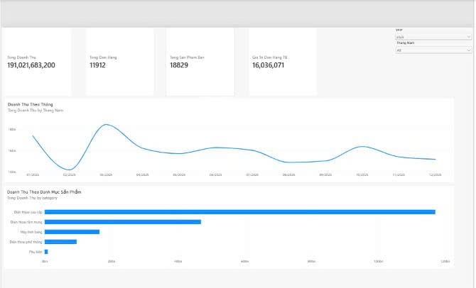

# KIỂM THỬ DASHBOARD – MEKONG MOBILE

## 1. Mục đích

Kiểm tra tính chính xác của các chỉ tiêu trên Dashboard Power BI bằng cách đối chiếu với kết quả tính toán độc lập từ Python.

Dashboard sử dụng mô hình Star Schema gồm:
- Fact_Sales
- Dim_Date
- Dim_Product
- Dim_Store

## 2. Phạm vi kiểm thử

- Kiểm tra KPI doanh thu toàn kỳ.
- Kiểm tra bộ lọc theo năm và tháng.
- Đối chiếu doanh thu, số đơn hàng và số lượng sản phẩm bán.
- Xác nhận chính sách xử lý dữ liệu thiếu ngày.

## 3. Kết quả kiểm thử

### TC01 – Tổng doanh thu toàn kỳ

Điều kiện: Year Slicer = All, Month Slicer = All.

| Chỉ tiêu | Kết quả Power BI | Kết quả ETL | Trạng thái |
|---|---:|---:|---|
| Tổng doanh thu (VND) | 415,773,438,750 | 415,773,438,750 | PASS |

### TC02 – Bộ lọc năm 2025

Điều kiện: Year Slicer = 2025, Month Slicer = All.

| Chỉ tiêu | Kết quả Power BI |
|---|---:|
| Tổng doanh thu (VND) | 191,021,683,200 |
| Tổng đơn hàng | 11,912 |
| Tổng sản phẩm bán | 18,829 |
| Giá trị đơn hàng trung bình (VND, làm tròn) | 16,036,071 |

Kết quả: PASS về mặt hiển thị và tương tác bộ lọc.

Lưu ý: Các giá trị trên chưa được đối chiếu độc lập với Python cho toàn năm 2025.

### TC03 – Bộ lọc tháng 03/2025

Điều kiện: Year Slicer = 2025, Month Slicer = 03/2025.

| Chỉ tiêu | Power BI | Python | Trạng thái |
|---|---:|---:|---|
| Tổng doanh thu (VND) | 18,454,832,750 | 18,454,832,750 | PASS |
| Tổng đơn hàng | 1,043 | 1,043 | PASS |
| Tổng sản phẩm bán | 1,700 | 1,700 | PASS |

Biểu đồ doanh thu theo tháng chỉ hiển thị tháng 03/2025.

## 4. Chính sách xử lý ngày thiếu

Có 154 dòng Fact_Sales không có date_key, bắt nguồn từ 114 hóa đơn thiếu ngày trong dữ liệu nguồn.

- Khi không áp dụng bộ lọc thời gian, các dòng này vẫn được tính vào tổng doanh thu.
- Khi lọc theo năm hoặc tháng, các dòng này không thuộc kỳ được chọn.
- Hệ thống không tự gán ngày giả định.

## 5. Kết luận

Các chỉ tiêu đã được đối chiếu độc lập giữa Power BI và Python đều cho kết quả khớp.

Bộ lọc năm và tháng hoạt động theo phạm vi dữ liệu được chọn.

Những phép kiểm thử này xác nhận các trường hợp đã kiểm tra, chưa thay thế việc kiểm thử toàn bộ bộ lọc, biểu đồ và các trường hợp ngoại lệ khác.

## 6. Minh chứng

Ảnh kiểm thử Dashboard tháng 03/2025:

Mã nguồn ETL: run_etl.py

Tài liệu Data Dictionary: docs/data-dictionary.md
