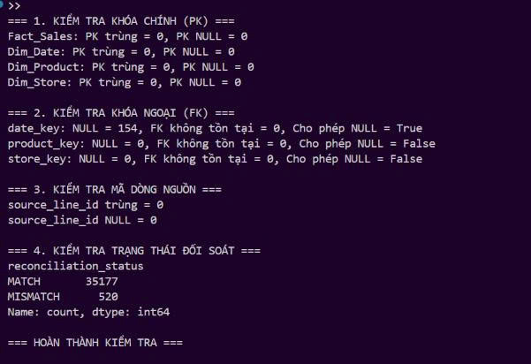

# DATA DICTIONARY – MEKONG MOBILE

## 1. Mục đích

Tài liệu mô tả cấu trúc dữ liệu của kho dữ liệu bán hàng Mekong Mobile theo mô hình Star Schema, nhằm đảm bảo sự thống nhất giữa thiết kế dữ liệu, quy trình ETL và kết quả kiểm thử.

Kho dữ liệu gồm 4 bảng:

- **Fact_Sales:** Lưu thông tin chi tiết bán hàng và kết quả đối soát doanh thu.
- **Dim_Date:** Lưu thông tin ngày phục vụ phân tích theo thời gian.
- **Dim_Product:** Lưu thông tin sản phẩm.
- **Dim_Store:** Lưu thông tin cửa hàng.

### 1.1. Quy ước

- **PK (Primary Key):** Khóa chính, dùng để định danh duy nhất một bản ghi.
- **FK (Foreign Key):** Khóa ngoại, dùng để liên kết giữa các bảng.
- **UNIQUE:** Giá trị không được trùng lặp.
- **NULL:** Giá trị có thể bị thiếu.
- **Surrogate Key:** Khóa thay thế được tạo trong quá trình ETL.
- **Grain:** Mức độ chi tiết của một bản ghi trong bảng Fact.

Các kiểu dữ liệu trong tài liệu là **kiểu SQL đề xuất cho kho dữ liệu mục tiêu**.

Ở giai đoạn hiện tại, hệ thống ETL xuất dữ liệu ra CSV. Các ràng buộc PK, FK và UNIQUE được kiểm tra bằng Python, chưa được thực thi trực tiếp trong hệ quản trị cơ sở dữ liệu.

### 1.2. Lưu ý về kiểu dữ liệu thực tế

Khi đọc CSV bằng pandas, kiểu dữ liệu có thể khác với kiểu SQL đề xuất.

| Cột | Kiểu pandas khi đọc CSV | Kiểu SQL đề xuất | Giải thích |
|---|---|---|---|
| Fact_Sales.date_key | float64 | INTEGER NULL | pandas suy luận kiểu float64 do cột có giá trị thiếu |
| Fact_Sales.order_id | int64 | VARCHAR(100) | Mã định danh được đề xuất lưu dạng chuỗi trong SQL |
| Dim_Product.product_id | int64 | VARCHAR(100) | Mã sản phẩm được đề xuất lưu dạng chuỗi trong SQL |
| Dim_Date.full_date | object | DATE | Ngày được đọc từ CSV dưới dạng chuỗi và cần chuyển đổi khi nạp vào database |
| Các cột tiền tệ | int64 | DECIMAL(18,2) | Dữ liệu hiện tại là số nguyên; thiết kế SQL sử dụng kiểu số thập phân |

**Lưu ý:** Kiểu `VARCHAR(100)` cho mã định danh là lựa chọn thiết kế SQL, không phải kiểu dữ liệu pandas hiện tại. Khi triển khai database cần chuyển đổi dữ liệu và thống nhất với ERD.

---

## 2. Fact_Sales

### 2.1. Mục đích

Fact_Sales lưu dữ liệu bán hàng ở mức chi tiết, đồng thời hỗ trợ kiểm tra chênh lệch giữa doanh thu ghi nhận từ nguồn và doanh thu được tính toán.

### 2.2. Grain

Mỗi bản ghi trong Fact_Sales tương ứng với **một dòng chi tiết sản phẩm trong một hóa đơn nguồn**, lấy từ `order_items.csv`.

Các dòng trùng hoàn toàn trong dữ liệu nguồn vẫn được giữ lại nhằm bảo toàn số dòng và giá trị nguồn.

Mỗi dòng được phân biệt bằng `source_line_id`, được tạo từ vị trí dòng vật lý trong file nguồn.

### 2.3. Data Dictionary

| Cột | Kiểu dữ liệu SQL đề xuất | Khóa / Ràng buộc | Mô tả |
|---|---|---|---|
| sales_key | BIGINT | PK | Khóa thay thế của bản ghi bán hàng, được tạo trong ETL |
| source_line_id | VARCHAR(100) | UNIQUE | Mã định danh dòng dữ liệu nguồn |
| order_id | VARCHAR(100) | | Mã hóa đơn nguồn |
| date_key | INTEGER | FK, NULL | Khóa liên kết Dim_Date, có thể NULL khi hóa đơn thiếu ngày |
| product_key | INTEGER | FK | Khóa liên kết Dim_Product |
| store_key | INTEGER | FK | Khóa liên kết Dim_Store |
| quantity | INTEGER | | Số lượng sản phẩm bán |
| unit_price | DECIMAL(18,2) | | Đơn giá ghi nhận từ dữ liệu nguồn |
| reported_sales_amount | DECIMAL(18,2) | | Thành tiền ghi nhận từ dữ liệu nguồn |
| calculated_sales_amount | DECIMAL(18,2) | | Thành tiền tính lại bằng số lượng nhân đơn giá |
| difference_amount | DECIMAL(18,2) | | Chênh lệch giữa thành tiền nguồn và thành tiền tính |
| reconciliation_status | VARCHAR(20) | | Trạng thái đối soát: MATCH hoặc MISMATCH |

### 2.4. Nguồn dữ liệu

Fact_Sales được xây dựng từ dữ liệu chi tiết bán hàng trong `order_items.csv`, kết hợp với thông tin hóa đơn trong `orders_2024_2026.csv` và khóa thay thế từ các bảng Dimension.

### 2.5. Quy tắc nghiệp vụ

**Quy tắc đối soát doanh thu:**

- Giữ nguyên `reported_sales_amount` để bảo toàn số tiền được ghi nhận từ nguồn.
- `calculated_sales_amount = quantity × unit_price`.
- `difference_amount = reported_sales_amount - calculated_sales_amount`.
- `reconciliation_status = MATCH` khi hai giá trị doanh thu bằng nhau.
- `reconciliation_status = MISMATCH` khi hai giá trị doanh thu khác nhau.
- Không tự động thay thế doanh thu nguồn bằng doanh thu tính toán.

**Quy tắc xử lý dữ liệu trùng:**

- Dữ liệu nguồn có 11 dòng chi tiết trùng hoàn toàn.
- ETL giữ lại các dòng này để bảo toàn dữ liệu gốc.
- Mỗi dòng vẫn được phân biệt bằng `source_line_id`.
- Không tự động loại bỏ dòng trùng khi chưa có quy tắc nghiệp vụ xác nhận chúng là bản ghi sai.

**Quy tắc xử lý ngày thiếu:**

- Không tự tạo ngày giả định cho hóa đơn thiếu ngày.
- Bản ghi thiếu ngày vẫn được giữ lại trong Fact_Sales với `date_key = NULL`.
- Các bản ghi này được tính trong tổng doanh thu không giới hạn thời gian.
- Các bản ghi có `date_key = NULL` không được đưa vào thống kê doanh thu theo ngày, tháng, quý hoặc năm.

---

## 3. Dim_Date

### 3.1. Mục đích

Dim_Date cung cấp thông tin thời gian để phục vụ phân tích doanh thu theo ngày, tháng, quý và năm.

### 3.2. Data Dictionary

| Cột | Kiểu dữ liệu SQL đề xuất | Khóa / Ràng buộc | Mô tả |
|---|---|---|---|
| date_key | INTEGER | PK | Khóa ngày theo định dạng YYYYMMDD |
| full_date | DATE | | Ngày đầy đủ |
| day | INTEGER | | Ngày trong tháng |
| month | INTEGER | | Tháng trong năm |
| quarter | INTEGER | | Quý trong năm |
| year | INTEGER | | Năm |

### 3.3. Nguồn dữ liệu

Nguồn: Cột ngày hóa đơn trong `orders_2024_2026.csv`.

### 3.4. Quy tắc biến đổi

- Chuẩn hóa các định dạng ngày khác nhau trong dữ liệu nguồn.
- Chuyển đổi ngày hợp lệ sang định dạng ngày thống nhất.
- Tạo `date_key` theo định dạng `YYYYMMDD`.
- Trích xuất các thuộc tính ngày, tháng, quý và năm.
- Chỉ tạo một bản ghi cho mỗi ngày hợp lệ.
- Không tạo Dim_Date cho các hóa đơn thiếu ngày hoặc có giá trị ngày không thể chuyển đổi.

---

## 4. Dim_Product

### 4.1. Mục đích

Dim_Product lưu thông tin mô tả sản phẩm, hỗ trợ phân tích doanh thu theo sản phẩm, thương hiệu và nhóm sản phẩm.

### 4.2. Data Dictionary

| Cột | Kiểu dữ liệu SQL đề xuất | Khóa / Ràng buộc | Mô tả |
|---|---|---|---|
| product_key | INTEGER | PK | Khóa thay thế của sản phẩm |
| product_id | VARCHAR(100) | UNIQUE | Mã sản phẩm trong dữ liệu nguồn |
| product_name | VARCHAR(255) | | Tên sản phẩm |
| brand | VARCHAR(255) | | Thương hiệu sản phẩm |
| category | VARCHAR(255) | | Nhóm sản phẩm |

### 4.3. Nguồn dữ liệu

Nguồn: `products.csv`.

### 4.4. Quy tắc biến đổi

- Đọc thông tin sản phẩm từ dữ liệu nguồn.
- Chuẩn hóa tên cột sang cấu trúc của Dimension.
- Đảm bảo mỗi `product_id` tương ứng với một bản ghi Dimension.
- Sắp xếp danh sách sản phẩm theo mã sản phẩm.
- Tạo `product_key` làm khóa thay thế.

Với cùng dữ liệu nguồn và cùng quy tắc sắp xếp, `product_key` được tạo nhất quán khi chạy lại ETL.

---

## 5. Dim_Store

### 5.1. Mục đích

Dim_Store lưu thông tin cửa hàng, hỗ trợ phân tích doanh thu theo cửa hàng, thành phố và quận/huyện.

### 5.2. Data Dictionary

| Cột | Kiểu dữ liệu SQL đề xuất | Khóa / Ràng buộc | Mô tả |
|---|---|---|---|
| store_key | INTEGER | PK | Khóa thay thế của cửa hàng |
| store_code | VARCHAR(100) | UNIQUE | Mã cửa hàng trong dữ liệu nguồn |
| store_name | VARCHAR(255) | | Tên cửa hàng |
| city | VARCHAR(255) | | Thành phố |
| district | VARCHAR(255) | | Quận/huyện |

### 5.3. Nguồn dữ liệu

Nguồn: `stores.csv`.

### 5.4. Quy tắc biến đổi

- Đọc thông tin cửa hàng từ dữ liệu nguồn.
- Chuẩn hóa tên cột sang cấu trúc của Dimension.
- Đảm bảo mỗi `store_code` tương ứng với một bản ghi Dimension.
- Sắp xếp danh sách cửa hàng theo mã cửa hàng.
- Tạo `store_key` làm khóa thay thế.

Với cùng dữ liệu nguồn và cùng quy tắc sắp xếp, `store_key` được tạo nhất quán khi chạy lại ETL.

---

## 6. Quan hệ giữa các bảng

Kho dữ liệu sử dụng mô hình Star Schema với Fact_Sales ở trung tâm và 3 bảng Dimension.

| Bảng Fact | Khóa ngoại | Bảng Dimension | Khóa chính | Quan hệ |
|---|---|---|---|---|
| Fact_Sales | date_key | Dim_Date | date_key | N:1 |
| Fact_Sales | product_key | Dim_Product | product_key | N:1 |
| Fact_Sales | store_key | Dim_Store | store_key | N:1 |

### 6.1. Nguyên tắc liên kết

- Mỗi dòng Fact_Sales liên kết với một sản phẩm thông qua `product_key`.
- Mỗi dòng Fact_Sales liên kết với một cửa hàng thông qua `store_key`.
- Mỗi dòng Fact_Sales có ngày hợp lệ liên kết với Dim_Date thông qua `date_key`.
- Dòng Fact_Sales có `date_key = NULL` không liên kết với Dim_Date nhưng vẫn được giữ lại.

### 6.2. Lưu ý khi phân tích doanh thu

Khi phân tích doanh thu theo thời gian, chỉ sử dụng các dòng Fact_Sales có `date_key` hợp lệ.

Khi tính tổng doanh thu không giới hạn thời gian, vẫn bao gồm những dòng Fact_Sales có `date_key = NULL`.

Quy tắc này giúp tránh tự suy diễn ngày bán đồng thời vẫn bảo toàn dữ liệu nguồn.

---

## 7. Kết quả kiểm thử ETL

### 7.1. Số lượng bản ghi

| Chỉ tiêu | Kết quả |
|---|---:|
| Số dòng Fact_Sales | 35.697 |
| Số dòng Dim_Date | 792 |
| Số dòng Dim_Product | 320 |
| Số dòng Dim_Store | 24 |
| Dòng đối soát MATCH | 35.177 |
| Dòng đối soát MISMATCH | 520 |
| Hóa đơn nguồn thiếu ngày | 114 |
| Dòng Fact_Sales thiếu date_key | 154 |
| Dòng Fact_Sales thiếu product_key | 0 |
| Dòng Fact_Sales thiếu store_key | 0 |
| Dòng chi tiết trùng hoàn toàn trong nguồn | 11 |

### 7.2. Kiểm tra bảo toàn dữ liệu

| Chỉ tiêu | Kết quả |
|---|---:|
| Số dòng chi tiết bán hàng nguồn | 35.697 |
| Số dòng Fact_Sales sau ETL | 35.697 |
| Chênh lệch số dòng | 0 |
| Tổng reported_sales_amount nguồn (VND) | 415.773.438.750 |
| Tổng reported_sales_amount trong Fact_Sales (VND) | 415.773.438.750 |
| Chênh lệch tổng doanh thu nguồn và Fact (VND) | 0 |

Các kết quả cho thấy số dòng chi tiết bán hàng và tổng doanh thu ghi nhận từ nguồn được bảo toàn sau ETL.

Kết quả này không đồng nghĩa với việc mọi trường dữ liệu đã được xác minh chính xác; các kiểm tra khóa, quan hệ và chất lượng dữ liệu được trình bày ở Mục 8.

---

## 8. Kiểm tra tính toàn vẹn dữ liệu (Data Integrity)

### 8.1. Mục đích kiểm thử

Kiểm tra tính toàn vẹn dữ liệu của mô hình Star Schema sau ETL, bao gồm:

- Tính duy nhất và không NULL của khóa chính (PK).
- Tính hợp lệ của khóa ngoại (FK).
- Tính duy nhất của mã dòng dữ liệu nguồn.
- Kết quả phân loại đối soát doanh thu.

### 8.2. Kết quả kiểm thử

| Hạng mục | Kết quả | Trạng thái |
|---|---|---|
| PK Fact_Sales | 0 trùng, 0 NULL | PASS |
| PK Dim_Date | 0 trùng, 0 NULL | PASS |
| PK Dim_Product | 0 trùng, 0 NULL | PASS |
| PK Dim_Store | 0 trùng, 0 NULL | PASS |
| FK product_key | 0 NULL, 0 tham chiếu không tồn tại | PASS |
| FK store_key | 0 NULL, 0 tham chiếu không tồn tại | PASS |
| FK date_key | 154 NULL, 0 tham chiếu không tồn tại | PASS |
| source_line_id | 0 trùng, 0 NULL | PASS |
| Đối soát doanh thu | 35.177 MATCH, 520 MISMATCH | PASS |

**Quy ước đánh giá:** PASS nghĩa là kết quả phù hợp với quy tắc chất lượng dữ liệu và ngoại lệ đã được xác định trong thiết kế.

### 8.3. Giải thích dữ liệu thiếu ngày

Dữ liệu nguồn có 114 hóa đơn thiếu ngày, tương ứng với 154 dòng chi tiết bán hàng trong Fact_Sales không có `date_key`.

Theo quy tắc nghiệp vụ:

- Không tự tạo ngày bán giả định.
- Giữ lại các dòng có `date_key = NULL`.
- Bao gồm những dòng này trong tổng doanh thu không giới hạn thời gian.
- Không đưa các dòng này vào phân tích doanh thu theo ngày, tháng, quý hoặc năm.

Việc có 154 giá trị NULL trong `Fact_Sales.date_key` là ngoại lệ được cho phép, không phải lỗi tham chiếu khóa ngoại.

### 8.4. Giải thích kết quả đối soát doanh thu

Trong tổng số 35.697 dòng bán hàng:

- 35.177 dòng có trạng thái MATCH.
- 520 dòng có trạng thái MISMATCH.

520 dòng MISMATCH phản ánh chênh lệch giữa số tiền nguồn và số tiền tính lại.

Hệ thống giữ cả hai giá trị doanh thu để phục vụ đối soát, không tự động sửa số tiền nguồn.

Do đó, trạng thái PASS của kiểm thử đối soát thể hiện việc dữ liệu được phân loại và bảo toàn theo quy tắc, không có nghĩa là tất cả dòng bán hàng đều có số tiền khớp nhau.

### 8.5. Kết luận kiểm thử

Các phép kiểm tra tính toàn vẹn dữ liệu đều đạt theo quy tắc thiết kế đã xác định.

Kết quả:

- Không phát hiện khóa chính trùng lặp hoặc có giá trị NULL.
- Không phát hiện khóa ngoại có giá trị không tồn tại trong bảng Dimension tương ứng.
- Không phát hiện source_line_id trùng lặp hoặc có giá trị NULL.
- Các bản ghi thiếu ngày được giữ lại đúng chính sách.
- Các trường hợp chênh lệch doanh thu được phân loại và bảo toàn.

Kết quả được kiểm tra bằng Python trên các file CSV đầu ra. Các ràng buộc PK, FK và UNIQUE chưa được thực thi trực tiếp trong cơ sở dữ liệu.

### 8.6. Minh chứng kiểm thử

**Mã nguồn kiểm thử:** `src/quality/check_warehouse.py`

**Ảnh minh chứng:**

---

## 9. Giới hạn hiện tại và hướng hoàn thiện

### 9.1. Giới hạn hiện tại

- Kho dữ liệu đang được lưu dưới dạng các file CSV.
- Chưa triển khai bảng vật lý và ràng buộc dữ liệu trong hệ quản trị cơ sở dữ liệu.
- Kiểu dữ liệu SQL trong Data Dictionary là thiết kế đề xuất.
- Các khóa thay thế được tạo trong ETL dựa trên dữ liệu hiện tại.
- Chưa có cơ chế cập nhật tăng dần và quản lý lịch sử thay đổi Dimension.
- Kiểm thử hiện được thực hiện trên dữ liệu CSV đầu ra.

### 9.2. Hướng hoàn thiện

- Triển khai kho dữ liệu vào hệ quản trị cơ sở dữ liệu nếu thuộc phạm vi đồ án.
- Chuyển đổi và kiểm tra kiểu dữ liệu theo Data Dictionary.
- Áp dụng ràng buộc PK, FK, UNIQUE và NULL theo thiết kế.
- Hoàn thiện các bài kiểm thử dữ liệu tự động.
- Xây dựng Dashboard phân tích doanh thu từ dữ liệu đã xử lý.
- Tiếp tục đối chiếu kết quả Dashboard với dữ liệu Fact_Sales.

Tài liệu Data Dictionary sẽ được cập nhật khi cấu trúc hoặc quy tắc dữ liệu có thay đổi.
